# Research Infrastructure Costing and Pricing Tool

## User Manual

**Audience:** Platform custodians, delegated approvers and administrators  
**Status:** Current application guide  
**Last updated:** 11 October 2026

The screenshots in this manual were taken with demonstration accounts and test figures. Names
and amounts in them are examples only.

## 1. Purpose

The tool helps UWA Research Infrastructure prepare, review, approve and retain costing records
for research platforms. A custodian records operating costs, recurrent funding, usable capacity
and forecast use. The application calculates rates and shows the assumptions and workings. A
delegated approver reviews the submission and either returns it for correction or approves and
seals it. Administrators manage accounts and can view all cycles, but cannot edit or approve
another user's costing record.

The application supports three account roles:

| Role | Main tasks |
| --- | --- |
| Platform custodian | Create and maintain own draft cycles, submit them, respond to returned cycles and export sealed records |
| Delegated approver | Review submitted cycles, return them for changes or approve and seal them |
| Administrator | Create and manage accounts, reset passwords, and view all cycles read-only |

The application uses local accounts. Use the application address supplied by your administrator.
For production, sign in through the approved HTTPS address.

## 2. Sign in and account security

1. Open the application and enter the username and password supplied by your administrator.
2. If this is your first sign-in with an administrator-issued password, the application asks you to change it before continuing.
3. Choose a password with at least 12 characters, including an uppercase letter, a lowercase letter, a number and a symbol.
4. Use **Password** at the top right of every page to update your password later. Changing it signs out other sessions for that account.
5. Select **Sign out** when finished, especially on a shared computer.

Five failed sign-in attempts temporarily lock the account for 15 minutes. If you believe your
password is correct but cannot sign in, check that the username is entered correctly and contact
your administrator if the lockout continues.

## 3. Platform custodian guide

### 3.1 Your cycle list

After signing in, the overview shows your costing cycles, their status, the last edit and the
step where a draft was left. Select **Resume** beside a draft to continue it. Select a submitted,
returned or sealed cycle to review its current state. The tiles across the top count your cycles,
those awaiting approval, your sealed records and unread notifications.

The menu on the left is the same on every page: **Overview**, **New costing cycle**,
**Notifications** and **Sealed records**.

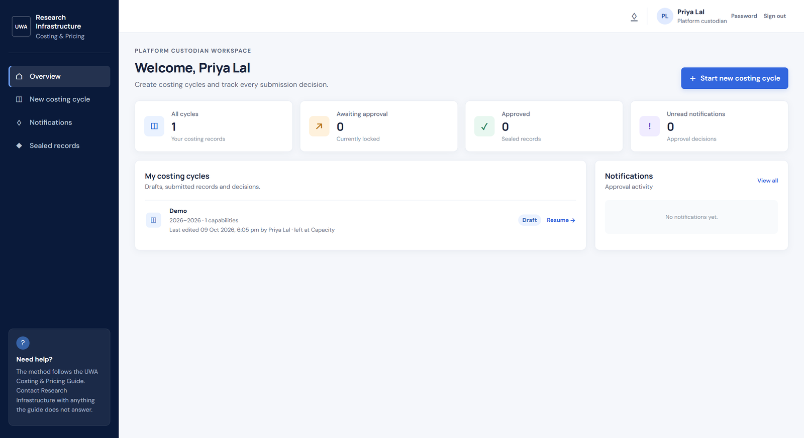

*Figure 1. The custodian's overview, with one draft cycle*

A cycle can have these statuses:

| Status | Meaning and next action |
| --- | --- |
| Draft | Editable by you. Continue entering information or submit when complete. |
| Submitted for approval | Waiting for an approver. It is locked while under review. |
| Returned · changes required | The approver has requested changes. Read the reason, edit the cycle and submit it again. |
| Approved | Sealed record. It is read-only and can be exported as a PDF. |
| Superseded | An older sealed record that a later cycle replaces. It remains available as an unchanged historical record. |

### 3.2 Start a cycle

1. Select **Start new costing cycle**.
2. Enter the platform name, the pricing period start and end years, and the billable unit: hours, days or samples.
3. Enter one capability per line. Capabilities are priced separately.
4. Select **Continue to costs**.

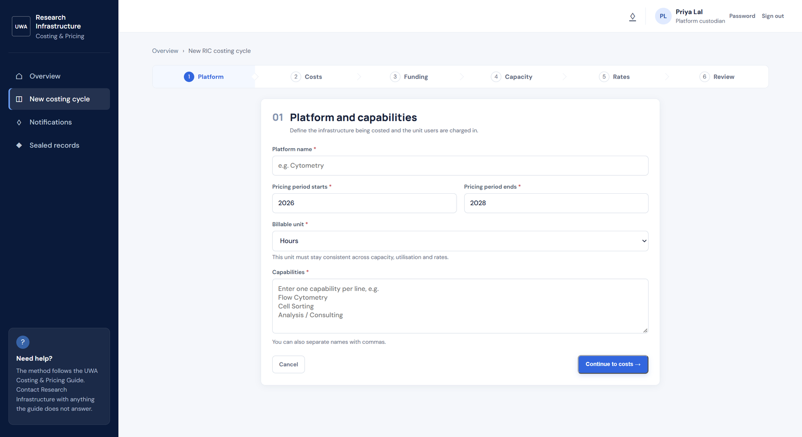

*Figure 2. Step 1, Platform and capabilities*

If a required field is missing, the page lists what to fix above the form and keeps what you
have typed.

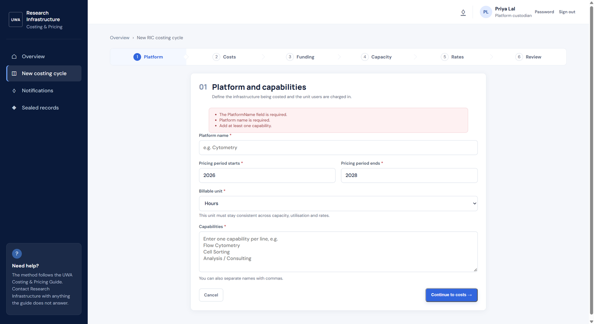

*Figure 3. Step 1 with the platform name and capabilities missing*

If the platform already has a sealed record, step 1 offers a link such as **Replace Cytometry,
2026–2028 →**. Use it when the new cycle is intended to supersede that record. This carries the
relationship into the new record and keeps the old sealed record unchanged. If this is a
genuinely separate cycle, tick **This is a separate cycle. It does not replace the sealed …
record.** instead. Changing the billable unit in an existing draft can clear capacity, forecast and
proposed-rate values; confirm that change only when intended.

### 3.3 Step 2: Costs

Add operating costs by category. The form is on the left; the running totals and the lines
already recorded are on the right.

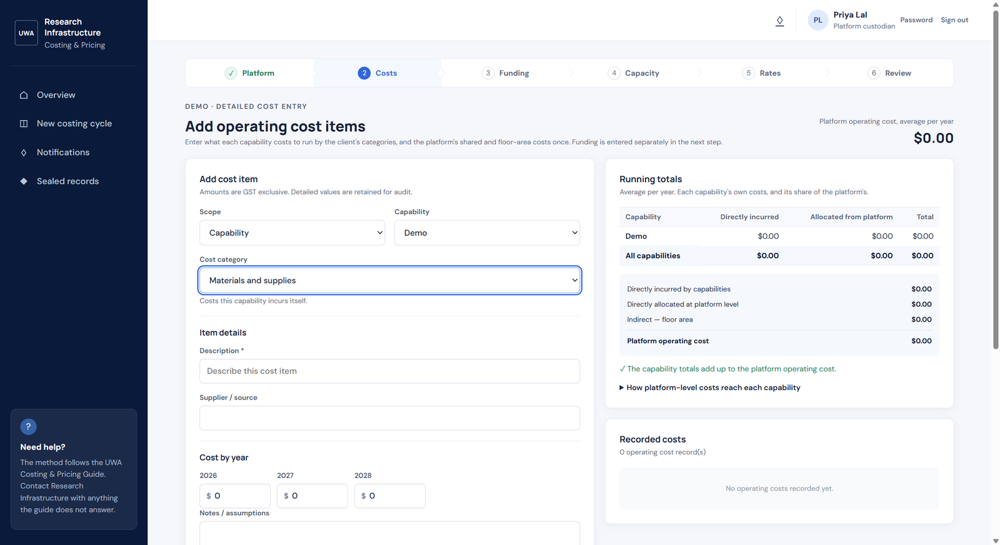

*Figure 4. Step 2, Costs: adding a cost item, with the running totals beside it*

For each line:

1. Choose whether it is incurred by a **Capability** or belongs to the whole **Platform**.
2. Select the relevant capability when the scope is Capability.
3. Select the cost category and complete the fields shown for it. Personnel, general items and floor-area costs request different details.
4. Enter the amount for each year in the pricing period. Amounts are GST exclusive.
5. Add notes or assumptions where useful, then select **Add cost item**.

For a staff line, choose the position funding type (ARC Fellow, ARC Funded Position, Chief
Investigator – UWA funded, LG funded or GP funded) and the staff type. Academic staff take a
salary level from A to E and professional staff a level from 1 to 10; the level list changes
with the staff type. The base salary is not yet filled in from the pay scales: enter the
person's full-time salary for a year, and each year they work is filled in as that salary ×
percent worked, plus superannuation, rising by the yearly increase if you give one. **Work
Years** starts at the whole pricing period; lower it for someone who works only the first year
or two, and the later years are left at nil. Change any year as needed; once a year has been
typed in, select **Fill years from salary** to work them out again. Leave the base salary blank
to type every year yourself.

To correct a saved line, select **Edit** beside it, change any field and save; the line is
updated in place rather than added again. A capability named wrongly on step 1 can be renamed
there: select **← Back to platform** at the foot of the costs step, or **Platform** in the step
bar at any time.

Review the running totals. Capability costs are directly incurred; platform-level costs are
allocated evenly across the capabilities. The screen shows the allocation and checks that the
capability totals reconcile to the platform total. Edit or remove an incorrect line before
moving on. Removing a capability later also removes its related costs and capacity, so confirm
such changes carefully.

### 3.4 Step 3: Funding

Record recurrent, non-variable funding separately from operating costs. The table at the top of
the form shows which rates each funding category reduces, and the panel on the right shows the
amount left to recover in user fees.

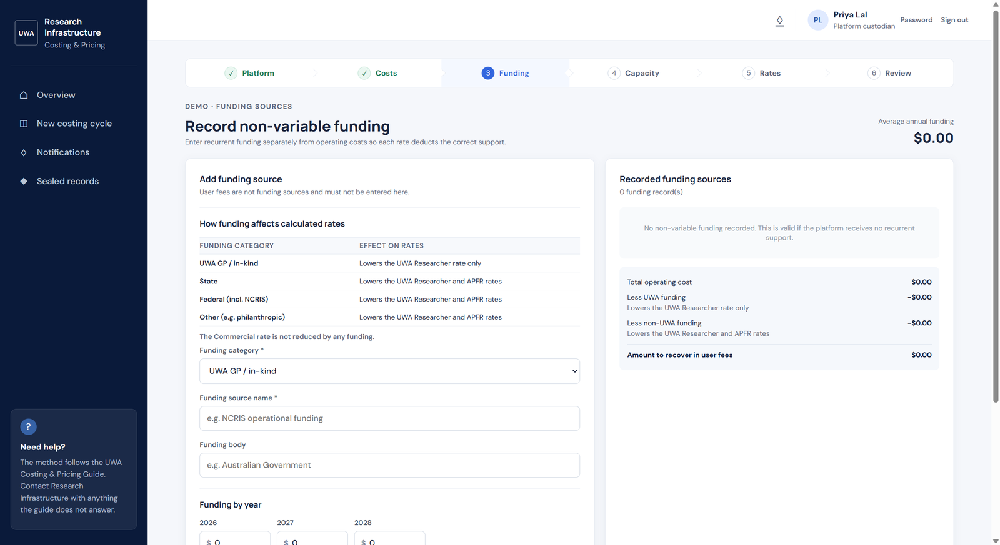

*Figure 5. Step 3, Funding*

For each source:

1. Select the funding category (UWA GP/in-kind, State, Federal including NCRIS, or Other).
2. Enter the source name and funding body where known.
3. Enter the amount for each year in the pricing period.
4. Explain where the funding comes from and how long it is committed for.
5. Select **Add funding source**.

Do not enter user fees as funding. The application applies funding to the relevant rate
calculations: UWA funding reduces the UWA researcher rate; non-UWA funding reduces the UWA and
APFR rates; funding does not reduce the commercial rate. No funding is valid when the platform
receives none.

### 3.5 Step 4: Capacity and forecast use

Complete the capacity and forecast for every capability. Figures are annual and use the cycle's
billable unit. Each capability has two panels: **Usable capacity** on the left and **Forecast
use** on the right, which shows the forecast as a percentage of usable capacity.

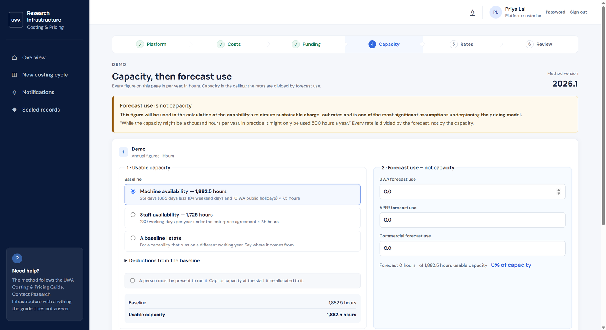

*Figure 6. Step 4, Capacity, then forecast use*


1. Choose the appropriate machine or staff baseline, or choose a stated baseline and record its source.
2. Enter deductions such as maintenance or other unavailable time, with a note explaining each deduction.
3. If a person must be present to run the capability, select the staff-reliant option and enter the allocated FTE. The usable capacity is capped by the staff time available.
4. Enter forecast use separately for UWA, APFR and commercial users.
5. Explain the utilisation assumptions, including factors such as maintenance, staffing, demand, weather or booking history where relevant.
6. If total forecast use is above usable capacity, either revise the forecast or explain how the forecast can be met.
7. Select **Calculate rates**.

Capacity is the ceiling; forecast use is the divisor used to calculate rates. Do not enter
capacity as forecast use unless the platform genuinely expects to use all available capacity.

The rates cannot be calculated until every capability has a forecast above zero and the
utilisation assumptions say how the forecast was reached. The page lists anything missing above
the first capability.

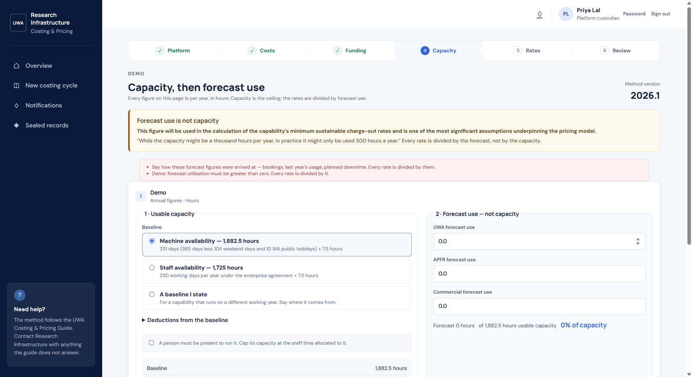

*Figure 7. Step 4 with no forecast use and no utilisation assumptions*

### 3.6 Step 5: Rates

The application displays calculated rates for each capability and user category: UWA
Researcher, APFR and Commercial. Each card says what the rate includes and which funding it
deducts. Expand **The figures behind these rates** to inspect the operating cost, funding
deductions and forecast-use divisor.

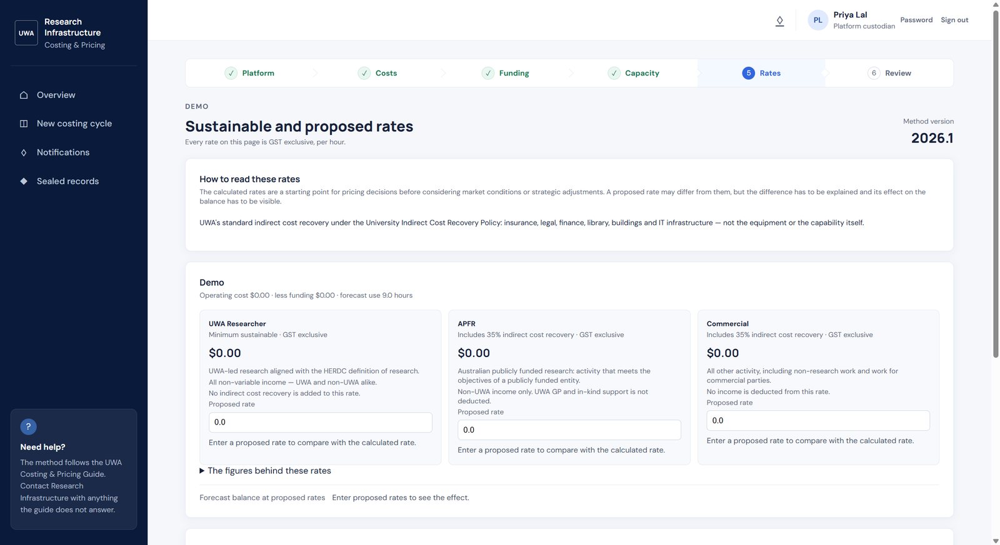

*Figure 8. Step 5, Sustainable and proposed rates*


1. Enter a proposed rate for UWA researcher, APFR and commercial users for each capability.
2. Compare each proposed rate with the calculated rate and review the variance.
3. Select **Update balance** to preview the overall surplus or deficit. The preview is not saved until you continue or go back using the page controls.
4. Record benchmarking notes and a pricing justification. Explain why a proposed rate differs from the calculated rate and how any forecast deficit will be managed.
5. Select **Review costing cycle** when ready.

The calculated rates are GST exclusive. The page identifies the method version and indirect-cost
recovery applied. A changed commercial rate displays the competitive-neutrality guidance.

### 3.7 Step 6: Review and submit

Review the totals, rates, balance, costing assumptions, utilisation assumptions, funding and
supporting details. Anything still missing is listed at the top under **Still needed before this
can be submitted**, each with a link such as **Fix on step 2, Costs →**. The panel on the right
repeats the guide's checklist: costing assumptions, utilisation assumptions and benchmarking.

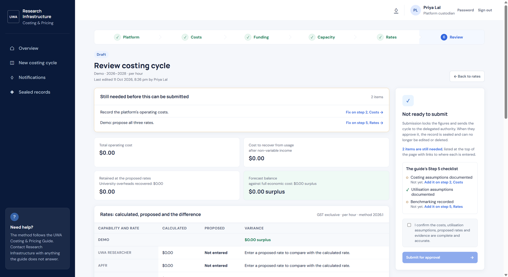

*Figure 9. Step 6, Review: two items still needed before submission*

When everything is ready, tick the confirmation that the costs, assumptions, proposed rates and
evidence are complete and accurate, then select **Submit for approval**. The cycle becomes locked
while the approver reviews it. You can follow its status and decision in your
cycle list or notifications.

### 3.8 Respond to a returned cycle

Open the returned cycle and read the approver's return reason. Select the relevant editable
steps, make the requested corrections and review the cycle again. Submit it when the changes are
complete. The approver's reason remains part of the cycle history.

### 3.9 Open and export a sealed record

A sealed cycle cannot be edited. Open **Sealed records** in the left menu to see your approved
records, open one to review the approved figures, and select **Download the sealed record (PDF)**
to download the sealed costing record. The PDF is rendered from the approved snapshot and
contains the calculation workings and record integrity information. Store or file it according
to your unit's records-management process.

If rates need to change later, start a new cycle that replaces the sealed record (§3.2). Do not
try to edit the approved record; the new cycle preserves the relationship while the historical
record remains unchanged. A record that has been replaced is marked **Superseded** and links to
the record that replaced it.

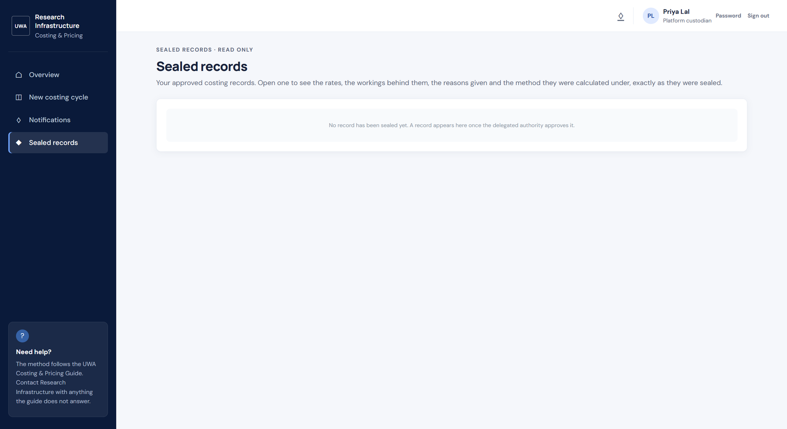

*Figure 10. Sealed records, before any record has been approved*

## 4. Delegated approver guide

### 4.1 Review queue

The approver's menu has **Overview**, **Sealed records** and **Approval queue**. Select
**Approval queue** to see pending submissions, ordered with the oldest first, and recent returned
or sealed decisions under **Recent decisions**. Open a pending cycle to review it.

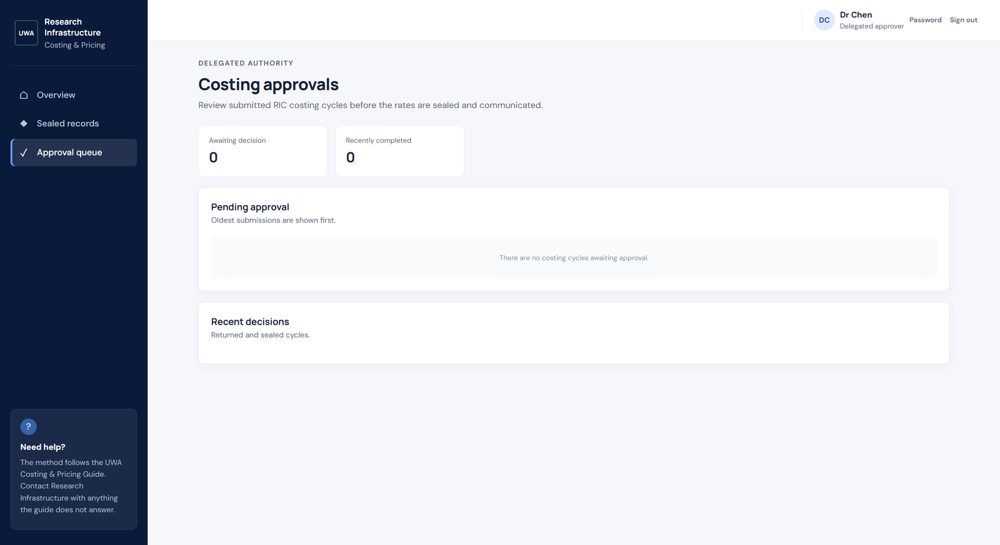

*Figure 11. The approval queue, with nothing awaiting a decision*

### 4.2 Review the submission

Before deciding, inspect:

- platform, pricing period, capabilities and billable unit;
- operating costs, funding sources and supporting detail;
- capacity baselines, deductions, staffing caps and forecast use;
- calculated and proposed rates and the resulting forecast balance;
- costing assumptions, utilisation assumptions, benchmarking notes and pricing justification;
- calculation workings and any explanation for forecast use above capacity.

The screen provides the inputs and workings together so you can assess how each rate was
reached. Raise concerns through **Return for changes** rather than approving a record with
missing or incorrect evidence.

### 4.3 Return for changes

1. Expand **Return for changes**.
2. State the specific corrections needed. Identify the affected capability, value or supporting explanation so the custodian knows what to address.
3. Select **Return to submitter**.

The custodian can edit the returned cycle and submit it again. The return reason is shown to the
custodian and retained with the cycle.

### 4.4 Approve and seal

1. Enter the effective date and an optional approval comment.
2. Read and select the confirmation that you have reviewed the costing basis, capacity assumptions, proposed rates and supporting evidence, and understand the record will become immutable.
3. Select **Approve & seal**.

Approval seals the record. Its figures, workings and reasons are stored as an immutable snapshot;
no one can edit or delete it. A later correction or pricing period requires a new cycle that
replaces the sealed record. Open the completed decision later from **Recent decisions**.

**Sealed records** in the approver's menu lists every approved record for every platform, read
only.

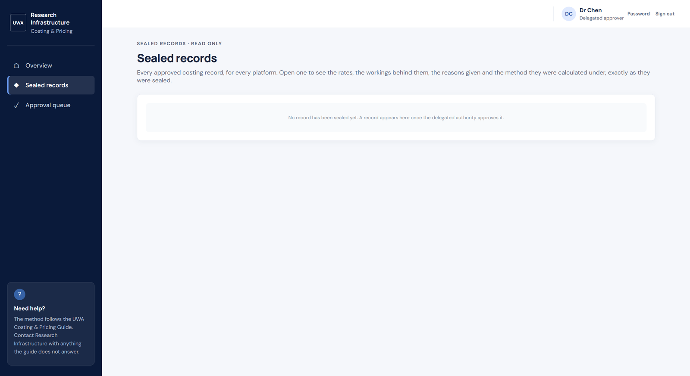

*Figure 12. Sealed records as the approver sees them*

## 5. Administrator guide

Administrators manage access and can view cycles across custodians. Administrator access does
not grant permission to edit another custodian's cycle or approve a submission. The
administrator's menu has **Overview**, **Sealed records**, **All costing cycles** and
**Accounts**.

### 5.1 Create an account

1. Open **Accounts**. Existing accounts are listed first; the form to create one is below them.
2. Under **Create an account**, enter a username, display name, role and initial password.
3. Use a lowercase username without spaces. The display name is recorded on cycles, so use the person's preferred work name.
4. Select the role: Platform custodian, Delegated approver or Administrator.
5. Choose an initial password meeting the displayed policy and select **Create account**.
6. Give the initial credentials to the user through a secure channel. They will be prompted to choose their own password at first sign-in.

Do not send passwords in ordinary email or place them in shared documents.

### 5.2 Reset a password or manage an account

The accounts table shows each user's role, active/deactivated state, last sign-in and number of
owned cycles.

- To reset a password, enter a compliant initial password in that account's **Reset password** field and select **Reset**. The user is signed out of other sessions and must choose a new password at next sign-in.
- To deactivate an account, select **Deactivate**. Its sessions are invalidated. The account and its attribution on existing records are retained.
- Select **Reactivate** to restore access for a deactivated account.
- You cannot deactivate the account you are currently using. Sign in with another administrator account to deactivate it if required.

Accounts are deactivated rather than deleted because their identity is retained on costing
records.

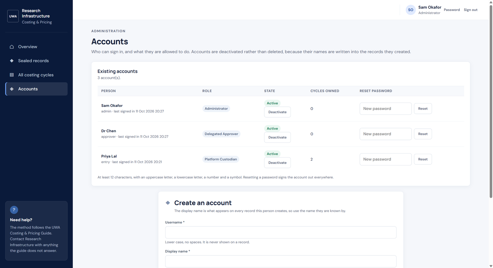

*Figure 13. Accounts: existing accounts, with the form to create one below*

### 5.3 View all cycles

Open **All costing cycles** to see every cycle. Filter by status or custodian and select a cycle
to inspect it. Administrator access is read-only: the custodian owns edits, and the delegated
authority owns approval and sealing.

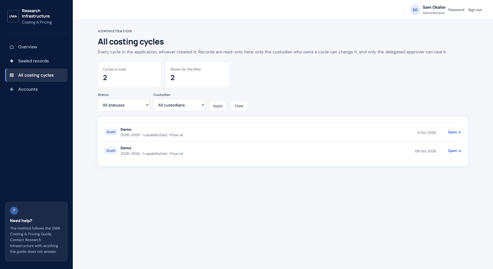

*Figure 14. All costing cycles, filtered by status and custodian*

## 6. Notifications and navigation

The custodian overview shows recent notifications and an unread count. Select **View all**, the
♢ icon at the top right, or **Notifications** in the left menu to open the notification list.
Approval decisions generate notifications for the relevant user. Notifications appear in the
application only; no email is sent.

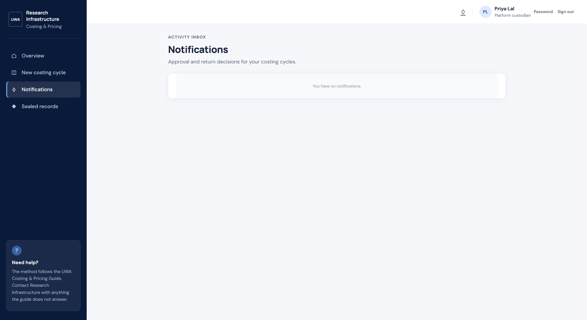

*Figure 15. The notifications inbox*

The six-step navigation is ordered: **Platform → Costs → Funding → Capacity → Rates → Review**.
Completed steps can be revisited while editing a draft. Use the page's **Save and continue**,
**Back** or other labelled controls rather than closing the browser when you have unsaved form
entries. The overview can resume a draft at its last recorded step.

## 7. Validation and troubleshooting

| What you see | What to do |
| --- | --- |
| “Invalid username or password” | Check the username and password. Confirm the account is active. After five failed attempts, wait 15 minutes or ask an administrator for a reset. |
| Password rejected | Use at least 12 characters, with uppercase, lowercase, number and symbol. |
| A cost or funding line is rejected | Check that required fields are filled, values are numeric and non-negative, and all years in the cycle have an amount. Confirm unusually large amounts when asked. |
| No rate can be calculated | Check that the capability has operating cost entries and a non-zero forecast use. Return to Costs or Capacity using the step navigation. |
| Forecast is above usable capacity | Reconsider the forecast or enter a clear explanation of how it can be met. The forecast, not the capacity, is the rate divisor. |
| Submit checklist shows missing items | Use the linked step beside each item to complete it, then return to Review. |
| Cycle is locked | Submitted cycles are waiting for an approver; sealed cycles are permanent. If returned, read the reason and edit the cycle. |
| Admin cannot edit or approve a cycle | This is intentional. Administrators manage accounts and view cycles; only the custodian edits and only an approver seals. |
| Login repeatedly returns to sign-in | Use the approved HTTPS application address. If the problem persists, contact the system administrator and include the time and page where it occurred. |
| A page reports an error | Do not retry a destructive action repeatedly. Note the cycle, page, time and visible message, then report it to the project/application support contact. Do not send passwords or sensitive costing details in the report. |

## 8. Good practice for costing records

- Use consistent billable units throughout the cycle.
- Distinguish directly incurred capability costs from platform-level costs.
- Enter non-variable recurrent funding in Funding, not as a negative cost or user fee.
- Record the source and assumptions behind amounts, baselines and forecasts.
- Treat the forecast as expected demand, not maximum capacity.
- Review the calculated-versus-proposed difference and explain the rationale for proposed rates.
- Check the readiness list before submission and the full workings before approval.
- Preserve sealed records. Use a replacement cycle for later changes.
- Export and file approved PDFs according to the unit's records-management procedures.

## 9. Role and workflow summary

```text
Custodian: Draft → enter and review → Submit
Approver:  Submitted → review → Return for changes OR Approve and seal
Custodian: Returned → correct and resubmit
Custodian: Sealed → view/export; create replacement cycle for future changes
Admin:     Create/manage accounts; view all cycles read-only
```
